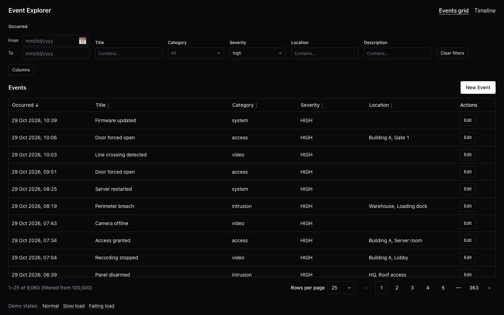
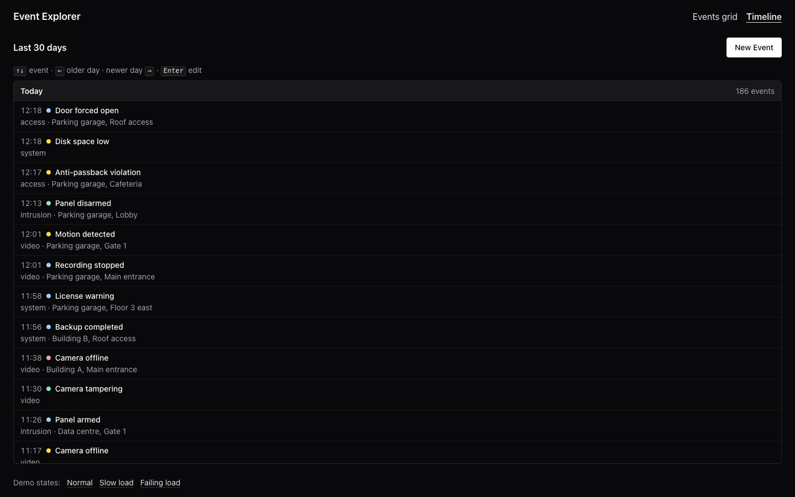

# Event Explorer

Three reusable React components, a DataGrid, a Timeline and an Event Form, in a small library (`@repo/ui`), plus a Next.js demo that runs them over 100,000 seeded security Events. The grid sorts, filters and pages the whole collection; the Timeline groups the last 30 days by day and is fully keyboard-driven; the form adds and edits Events, and both views update optimistically.

## Quick start

Requires Node 24 (see `.nvmrc`); pnpm comes from the `packageManager` field through Corepack.

```sh
corepack enable
pnpm i
pnpm dev
```

Open http://localhost:3000. For production timings, run `pnpm build && pnpm start` instead.

`dev` and `build` run Next with `--webpack`, not Turbopack: Chakra UI styles through Emotion at runtime, which Turbopack can hydrate incorrectly ([ADR 0002](docs/adr/0002-chakra-inside-the-library-next-runs-webpack.md)).

`pnpm lint` and `pnpm typecheck` check the whole workspace.

## Try it

The landing page links to the two views; the header's nav switches between them.

### Events grid (`/events`)



- Click a column header to sort (ascending, descending, off); Occurred, newest first, is the default.
- Narrow with the filter bar: Title, Location and Description contain text, Category and Severity pick from a list, Occurred takes a date range. Clear filters resets them. Below `lg` the bar collapses behind a Filters toggle.
- Hide and show columns from Columns; page through 25, 50 or 100 rows at a time.
- Edit opens the Event in the dialog.
- Copy the URL into another tab: same page, sort, filters and columns.

### Timeline (`/timeline`)



- Tab into the Timeline, then Up / Down move by Event, Left / Right jump to the older / newer day, Home / End stay within the day, Ctrl+Home / Ctrl+End reach the ends, PageUp / PageDown move a screenful.
- Enter, Space or a click opens the Event for editing.
- The Timeline always shows the whole Timeline Window: the filters belong to the grid.

### Adds to both

On `/timeline`, press New Event and save an Event dated today: it lands in Today, and the toast names its day. Open Events grid: with the default sort it is the first row of page 1.

### Demo states

The footer's Demo states links reload the current page, keeping its view params:

- **Slow load** (`?delay=3000`) shows each view's skeleton.
- **Failing load** (`?fail=1`) shows each view's error state.
- **Normal** removes both.

## Repo layout

```
apps/demo           Next.js app: landing page, /events, /timeline, mock /api/events
packages/ui         @repo/ui, consumed as source
  src/datagrid      @repo/ui/datagrid    DataGrid compound component, createColumns
  src/timeline      @repo/ui/timeline    Timeline compound component, createTimeline
  src/event-form    @repo/ui/event-form  EventForm, Event types
  src/theme         @repo/ui             UiProvider, Chakra system (Severity / Category tokens)
docs/adr            Architecture decision records
```

`AGENTS.md` describes the file layout rules, and [`GLOSSARY.md`](GLOSSARY.md) defines the domain terms (Event, Category, Severity, Timeline Window, Day Group).

## Decisions and trade-offs

- **TanStack Table v9 inside the DataGrid, not AG Grid Community**: the component's API, `<table>` semantics and states are the deliverable ([ADR 0001](docs/adr/0001-tanstack-table-over-ag-grid-community.md)).
- **Chakra UI inside the library, so Next runs `--webpack`** ([ADR 0002](docs/adr/0002-chakra-inside-the-library-next-runs-webpack.md)).
- **The DataGrid paginates, not virtualizes, its 100k rows**; the Timeline covers the scrolling case ([ADR 0003](docs/adr/0003-paginated-not-virtualized-datagrid.md)).
- **DataGrid view state optionally controlled; the demo keeps it in the URL.** The grid draws no filter controls: the demo's filter bar passes values in ([ADR 0004](docs/adr/0004-datagrid-view-state-is-controlled-and-lives-in-the-url.md)).
- **Filters are the grid's alone.** The Timeline takes no filters and shows the whole Timeline Window; its focus stays uncontrolled and out of the URL (ADR 0004).
- **The Timeline is a one-column grid, and Left / Right jump between days** ([ADR 0005](docs/adr/0005-timeline-is-a-one-column-grid-with-day-jumps.md)).
- **One route per view (`/events`, `/timeline`).** The brief allows a single page or two routes; two routes give each view the full viewport and the grid its own shareable URL, at the cost of not seeing an add land in both views at once (see Try it → Adds to both).
- **A mock API plus TanStack Query as the only client store.** `/api/events` serves seeded Events from server memory; the client loads them once into one pinned query, and writes update that cache optimistically, rolling back with a toast if the server rejects them.
- **Source-only workspace.** `@repo/ui` has no build step; the demo compiles it.
- Built with AI assistance (Claude Code; its skills live in `.claude/` and `.agents/`). Every change was reviewed and committed by hand.

## Accessibility

- The DataGrid is a native `<table>` with `scope="col"` headers and `aria-sort` on the sorted one; a sort change and the current page range are announced through polite live regions.
- The Timeline follows the APG grid pattern: one `rowgroup` per Day Group, `aria-rowcount` / `aria-rowindex` so position survives virtualization, and roving focus tracked by Event id. Crossing into another day prefixes the Event's name with its day, without a live region. A visible key hint doubles as the grid's description.
- The Event Form focuses the first invalid field on Save, and errors then clear as they're fixed.
- The dialog doesn't restore focus to its opener, which may be gone after a save: the page moves focus itself, to the Edit button, the `Events` heading or the Timeline, and New Event after an add.

## Known limits

- **Arrow wording is English.** The key hint's "older day" / "newer day" text is a default; `Timeline.KeyHint` takes `children` to replace it.
- **Data lives in server memory.** Edits survive reloads but reset when the dev server restarts.

## Next steps

- Unit tests (the brief doesn't require them): the grid's pipeline, the Timeline's key model and the form's validation are the first candidates.
